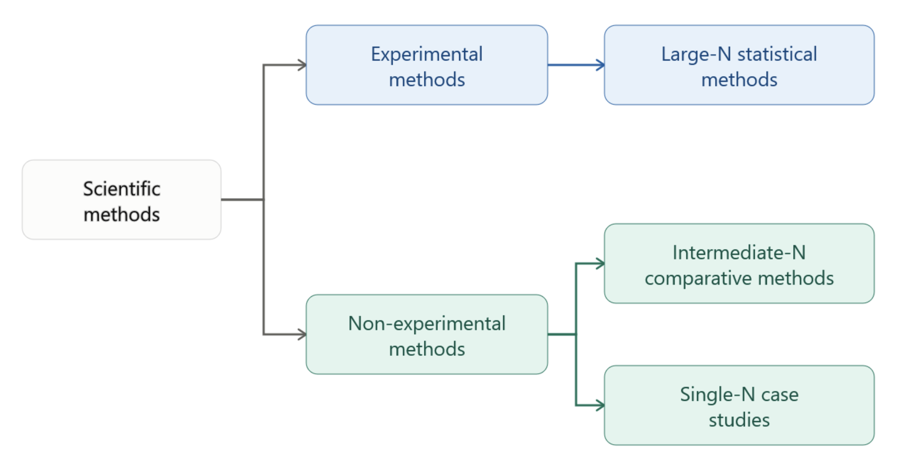
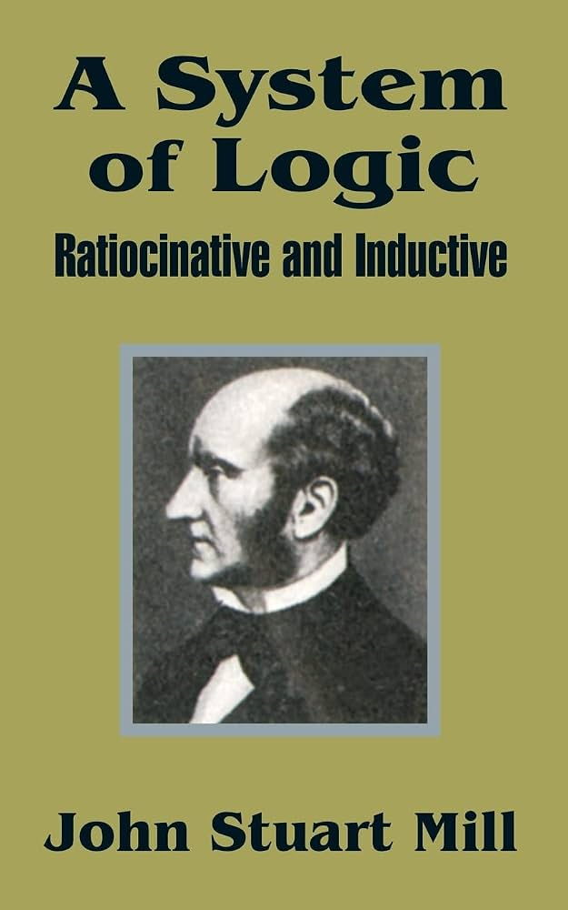

# Chapter 2: How to Study Comparative Politics: Using Comparative Methods

## 2.1: The Scientific Method and Comparative Politics

::: callout-note
### Learning Objectives

By the end of this section, you will be able to:

- Consider the factors that make political science, and thereby comparative politics, a science.
- Identify and describe the steps used in the scientific method.
:::

### Introduction

Many people, when asked to envision ‘science,’ imagine laboratories filled with researchers in white lab coats experimenting with chemicals in bubbling vials and covering chalkboards with mathematical equations. These images represent the ‘natural sciences,’ such as chemistry, mathematics, and physics. Researchers in the natural sciences work to advance our understanding of natural phenomena, including life, matter, energy, and the physical universe.

The ‘social sciences,’ including psychology, sociology, and political science, are also scientific disciplines. Social science researchers work to advance our scientific understanding of human behavior, institutions, society, government, decision-making, and power. Both natural and social sciences provide significant contributions to the world of scientific inquiry and rely on the scientific method, but they face different challenges. Physicist Heinz Pagels (1988) highlights a major challenge in social science research by referring to the social sciences as the “sciences of complexity.” Numerous factors influence social phenomena and, in many cases, experimentation is not possible. For instance, it is impossible to randomly assign authoritarian leaders to some countries and democratic leaders to others and then measure how outcomes differ among the two sets of cases.

The term **science** refers to the systematic and organized approach to inquiry that utilizes scientific methods to acquire and build a body of knowledge. Political scientists use scientific methods to gain knowledge. As defined in Chapter 1, "comparative politics is a subfield of political science that seeks to advance understanding of political structures around the world in an organized, methodological, and clear way." To this end, political scientists apply the principles of scientific inquiry in their research. The following sections will introduce how these principles apply to the study of comparative politics.

### Why is Political Science a Science?

While ancient political thinkers like Aristotle, Plato, Socrates, and Thucydides provided important observations on political life, they did not always operate under a strictly scientific framework. In some instances, these thinkers used a normative approach, focusing on how the political world *should* be. However, modern political science, like the other social sciences, relies on the scientific method. Researchers in political science emphasize **empirical research**, which is based on observation, experience, or experimentation rather than normative analysis.

Gary King, Robert Keohane, and Sidney Verba’s *Designing Social Inquiry: Scientific Inference in Qualitative Research* (1994) summarizes the features of empirical scientific research in political science. Much of the book focuses on qualitative research methods, which will be discussed later in this chapter. The authors also outline the general principles of scientific research in political science.

::: {#fig-2-1-1}
{fig-alt="Book cover of Designing Social Inquiry: Scientific Inference in Qualitative Research, featuring an abstract geometric painting with blue, yellow, and black patterns." width="320"}
:::

According to King, Keohane, and Verba (1994), scientific research has four main characteristics.

First, one of the primary purposes of scientific research is to make descriptive or causal inferences. An **inference** is a process of drawing a conclusion about an unobserved phenomenon based on observed (empirical) information. A *descriptive inference* summarizes observed data while a *causal inference* identifies the causes of observed effects. The accumulation of facts alone does not make research scientific, no matter how systematically those facts are collected. To be scientific, a study must go beyond the immediately observable information in order to draw conclusions about broader, unobserved phenomena. For example, although it is not possible to directly observe the concept of ‘democracy,’ political scientists identify various characteristics of democratic states, which can then be used to describe and measure the concept. Ultimately, science is not defined by the amount of data collected, but by the ability of researchers to use that data to make meaningful conclusions about the world.

Second, the procedures of scientific research must be public. Scientific research relies on "explicit, codified, and public methods" so that others can assess the validity (accuracy) and reliability (consistency) of a study's results. As a condition for publication, publishers often require authors to share data files to ensure that other researchers can replicate the findings, allowing for ongoing assessment. This transparency holds researchers accountable and advances the cumulative development of scientific knowledge.

Third, because the process of making inferences is imperfect, the conclusions of scientific research are also uncertain. Researchers must therefore account for this uncertainty in their work when interpreting and qualifying their conclusions. They do this by explicitly describing the limits of their data, highlighting potential flaws in their research design, and leaving room for alternative explanations.

Fourth, scientific research depends on method rather than subject matter. This means that the way research is conducted, rather than what is being studied, determines whether it is scientific. Scientific research must adhere to a set of rules related to inference, which are grounded in the scientific method. The following section outlines these foundational rules.

### The Scientific Method

The **scientific method** follows a sequence of steps to standardize the research process: asking a research question, conducting background research, developing hypotheses, testing hypotheses, analyzing results, and reporting findings. The following overview examines each phase.

#### Step One: Asking a Research Question

The first step in the research process is to develop a clear, focused, and relevant research question. What characteristics define a good research question in political science?

First, the research question must be relevant to the real political world. This does not mean that a research question must address current political affairs; in fact, many political scientists study historical events and past political behaviors. However, the results of political science research are often relevant to the current political environment and may even offer important policy implications. Second, the question must be ‘falsifiable.’ **Falsifiability**, a term coined by Karl Popper in 1934, is the ability for a statement to be logically contradicted by empirical evidence. Some research questions or claims are inherently non-falsifiable, meaning they can never be proven false. This typically occurs under two conditions: when the question is purely subjective (such as "Are oranges better than lemons?"), or when technical limitations make gathering evidence impossible (for instance, "Do angry ninja-robots live in Alpha Centauri?").

Suppose a political scientist started with the following research question: "Is Argentina or Brazil better?" This question is subjective. What does "better" mean? This will depend entirely on an individual's personal taste. To refine this into a viable question for scientific inquiry, the researcher will need to define "better." For example, the researcher may alter the question to the following: "Is Argentina or Brazil more economically productive?" This is a question on which the researcher can actually gather evidence. They can establish concrete metrics for economic productivity, gather empirical data, and compare the two countries directly.

Now consider a political scientist who asks: "Does investing heavily in a country's education system always mean that country will eventually become democratic?" This question presents two distinct technical limitations. First, the word “always” implies that a researcher will have to verify every single past and future instance of educational investment worldwide (in addition to defining what "heavily" means). Second, the word "eventually" introduces an untestable time horizon. After all, a country investing in education today might eventually become democratic 500, 700, or even 900 years into the future. Because it is simply impossible to gather the necessary evidence to evaluate the premise, the question as currently phrased is non-falsifiable. These examples point to the importance of formulating research questions that are both specific and testable.

#### Step Two: Conducting Background Research

The second step in the research process is to conduct background research. Before formulating a hypothesis or gathering data, researchers need to complete a ‘literature review’ to situate themselves within the field. A **literature review** is a survey and synthesis of existing scholarly research on a topic. It summarizes prior research findings, methodological approaches, relevant theories, remaining limitations, and unresolved questions.

By reviewing existing scholarship, researchers can identify what is already known about a topic, understand where disagreements exist, and find gaps in the literature where their own work can contribute.

A literature review may take various forms, depending on the nature of the research question.

- **Chronological:** This approach arranges the research in historical order, beginning with foundational early research and culminating in the most recent studies on a topic.
- **Thematic:** This approach organizes previous research into specific groups or categories. For example, scholars A, B, and C argue that democracy leads to economic growth, while scholars X, Y, and Z argue that economic growth leads to democracy.
- **Methodological or Theoretical:** This approach focuses on the varying methods or theories that previous scholars have used to explain the topic.

No matter the form it takes, conducting background research to create a literature review is an important phase of the research process. It allows a scholar to showcase, summarize, and synthesize previous research, while simultaneously demonstrating why their specific research question deserves attention.

#### Step Three: Developing Hypotheses

The third step in the research process is to develop a hypothesis, or a set of hypotheses. A **hypothesis** is a specific and testable prediction about the relationship between variables. A **variable** is any factor that can vary, meaning it can take on different values. In a hypothesis, the researcher will identify two core types of variables: an independent variable and a dependent variable. In a cause-and-effect relationship, the independent variable (also called an ‘explanatory variable’) is the presumed cause, while the dependent variable (also called an ‘outcome variable’) is the assumed effect. The independent variable leads to a change in the value of the dependent variable. In other words, the dependent variable's value depends on the changes in the independent variable. For example, consider the hypothesis: "Spending more time consuming political videos on social media increases an individual's animosity toward opposing political groups." In this scenario, the time spent consuming these videos is the independent variable because it is the presumed cause. One's level of animosity is the dependent variable because it is expected to change based on one's video consumption levels.

While a hypothesis is a testable prediction about a specific relationship, a theory is a broader, systematic statement that explains how some aspect of the political world works. An existing theory will often help a researcher build their hypotheses, and over time, the repeated testing of hypotheses can help confirm, refine, or build a new theory.

To develop (step three), or later test (step four), a hypothesis, researchers may use either inductive or deductive reasoning. **Inductive reasoning** is a bottom-up approach where researchers gather specific observations to build a hypothesis and, eventually, a broader theory. **Deductive reasoning** is a top-down approach where researchers start with an existing broad theory and then collect specific observations to test its validity.

#### Steps Four and Five: Testing Hypotheses and Analyzing Results

The fourth and fifth steps in the research process work in tandem: testing hypotheses and analyzing results. The precise manner in which a researcher tests hypotheses depends on the research method they employ (which will be explored in detail in the following section), but all testing requires a researcher to make observations on the relationship between the variables in the hypothesis.

When the testing is complete, researchers analyze their results and draw conclusions about their findings. Do the results provide evidence in support of the hypothesis? If so, this suggests that the researcher may be on the right track. If not, the researcher will need to go back to the drawing board, develop a new hypothesis, and conduct testing again.

#### Step Six: Reporting Findings

The sixth step in the research process is to report findings. While not all research results in formal academic publication, researchers can still share their findings through conferences, books, articles, or digital media. This open information-sharing allows others to provide feedback, spot errors, and inform their own research on the topic. It also spawns new and interesting directions for future research.

Why is it so important to report findings? Consider the difference between two global pandemics.

The 1918 Influenza Pandemic (also known as the Spanish Flu) began during the final months of World War I. In order to project military strength and improve public morale, many nations deliberately censored media stories about the scale and impact of the virus. In the midst of this hindered press, doctors struggled to openly communicate their ideas and treatment plans for handling flu patients. Inundated with swarms of patients and flummoxed by the nature of a flu that was killing young, healthy adults, but largely sparing older individuals, doctors tried many treatment methods, yet were unable to broadly share their results.

In contrast, during the COVID-19 pandemic, doctors worldwide were able to share their ideas and treatment plans in real time. For example, while hospitals initially relied heavily on mechanical ventilators, doctors soon discovered that ‘prone positioning’ (simply turning patients on their stomachs) was a more effective strategy for opening a patient’s lungs and improving their oxygen levels. This real-time collaboration allowed the information to spread quickly, leading to changes in hospitals throughout the world, and ultimately saving lives.

This contrast illustrates how the sharing of results can be critical to learning about a research question. If researchers are unable to share what they learn, it can stall our collective advancement of knowledge.

## 2.2: Four Approaches to Research

::: callout-note
### Learning Objectives

By the end of this section, you will be able to:

- Distinguish between correlation and causation.
- Compare and contrast four different approaches to research.
:::

### Introduction

In empirical research, there are four basic approaches: experimental methods, statistical methods, comparative methods, and case study methods. Each of these methods is an attempt to understand the relationship between two or more variables, which may be correlational or causal. Each method involves crafting good research questions, using existing theories to inform the understanding of the research problem, and generating and testing hypotheses. The difference between correlation and causation will first be discussed, followed by an overview of each research approach.

### Correlation and Causation

When assessing the relationship between an independent variable (X) and a dependent variable (Y), researchers must determine whether the connection is a simple correlation or a true causal relationship. A **correlation** describes how two variables change in relation to one another. If they show a ‘positive correlation,’ they increase or decrease together, meaning that as X increases, Y increases, and as X decreases, Y decreases. If the variables show a ‘negative correlation,’ they move in opposite directions: as X increases, Y decreases, and as X decreases, Y increases. If they show ‘no correlation,’ there is no apparent linear relationship between them. A **causal relationship**, however, goes beyond a mere correlation. It establishes a direct cause-and-effect connection where changes in X directly cause changes in Y.

**Correlation does not imply causation.** Just because a researcher observes a relationship between two variables does not mean that one *causes* the other. Connections are sometimes spurious, meaning the relationship is misleading and does not reflect a true causal connection. For instance, suppose a researcher observes a positive correlation between ice cream sales and crime rates. As ice cream sales increase, crime rates also increase. This does not mean that ice cream sales cause crime. In this case, both variables tend to increase with warm weather. Warm weather is thus a ‘confounding variable’ that influences both variables, creating a spurious relationship. In research, spurious relationships often arise if a researcher leaves out variables that influence both the independent and dependent variables in their analysis (referred to as ‘omitted variable bias’).

::: {#fig-2-2-1}
{fig-alt="Conceptual diagram contrasting causation and correlation: on the left, a single directional arrow shows Variable X directly causing Variable Y; on the right, a bidirectional arrow shows Variable X and Variable Y moving together with an unclear causal direction."}
:::

In comparative politics research, a clear positive correlation exists between *economic development* and *democracy*. Countries with higher levels of economic development, measured by GDP per capita, tend to be more democratic when measured by a democracy index. However, this correlation does not automatically prove a causal relationship. Economic development may cause democracy, democracy may cause economic development, or a third variable (Z) may cause both. For example, political stability arising from the absence of war (Z) may facilitate both economic development and democracy. Alternatively, there may be an intervening variable (A) linking the two. For instance, economic development might lead to an accumulation of wealth (A), which then supports democratization.

Because there are so many plausible explanations, a researcher cannot claim a causal link based on correlation. In fact, there are even numerous exceptions to this pattern. Oil-producing countries in the Persian Gulf, such as Saudi Arabia and the United Arab Emirates, have high levels of economic development without democracy. Meanwhile, countries like Senegal and India are democratic despite their relatively low levels of economic development.

These potential challenges force researchers to be very careful when making causal inferences in political science. Establishing causality is always difficult, but this is especially true when the unit of analysis involves countries, as is often the case in comparative politics.

### Experimental Methods

One way that a researcher can attempt to establish causality is through experimental methods. **Experiments** are "laboratory studies in which investigators retain control over the recruitment, assignment to random conditions, treatment, and measurement of subjects" (McDermott, 2002, p. 32). In an experiment, the researcher directly controls the independent variable of interest, known as the ‘treatment.’  Through random assignment, this treatment is given to some cases (the treatment group) and withheld from others (the control group). The researcher then observes the effect that the treatment has on the outcome, the dependent variable of interest. This random assignment allows the researcher to ‘control’ for any potential confounding variables—observable or unobservable—because the randomization process evenly distributes participants across the treatment and control groups. The experimental method therefore reduces bias (Druckman, et. al., 2011) by ensuring comparability across groups, which allows a researcher to isolate the causal impact of the treatment. While a laboratory experiment provides the absolute best conditions for researcher control, conducting a lab experiment at the country level is impossible. There are, however, field experiments and natural experiments, both of which are frequently used by comparativists to establish causality. A **field experiment** takes place in a real-world setting rather than a laboratory. For example, a researcher may want to learn how a political candidate's ethnic background (X) influences voter behavior (Y). Prior to an election, the researcher may distribute informational flyers to voters, randomly assigning one group to receive a flyer highlighting the candidate's ethnic background (the treatment group) while another group receives a flyer without that information (the control group). The researcher then measures the effect of the treatment on actual voting behavior. Because these studies happen in the real world, the researcher possesses less control over the environment than they would in a laboratory experiment.  As a result, they must be aware that there is a higher risk of bias in field experiments than in a lab.

A ‘natural experiment’ is not an experiment designed by the researcher, but rather a specific type of observational study. In an **observational study**, the researcher does not control a treatment (as they would in a laboratory or a field experiment), but instead simply observes outcomes. A **natural experiment** occurs when the random assignment of a ‘treatment’ occurs naturally or due to some factor outside of the researcher’s control. For example, suppose a national government uses a random lottery to select some local governments to receive a massive influx of education funding. Setting aside the ethical concerns of this hypothetical policy, a researcher could take this opportunity to study the policy’s impact, comparing the educational outcomes of the lucky recipients (the treatment group) against those that received nothing (the control group). If true randomization exists, which is a claim that the researcher must clearly demonstrate, a natural experiment can provide a basis for establishing causality.

### Statistical Methods

Statistical methods offer another important approach to comparative research. As discussed in Chapter 1, statistical methods are central to quantitative research, which focuses on testing hypotheses through mathematical analysis of large datasets. This approach allows scholars to uncover patterns and correlations in large-N research, which are studies that include a large sample size. However, these methods are primarily a mode of analysis and their use, on its own, does not typically allow researchers to claim causation.

Many researchers default to statistical analysis to uncover correlations in applied research. Applied research is "research that attempts to explain social phenomena with immediate public policy implications" (Knoke, et al., 2002, p. 7). Scholars frequently utilize existing data from various sources, including government agencies, think tanks, and other research institutions, probing for correlations among variables to test their hypotheses (Omae and Bozonelos, 2020). For example, a researcher interested in education policy might pull state-level data from the U.S. Department of Education and analyze whether per-pupil spending correlates with standardized test scores. Finding a positive correlation would not, on its own, prove that spending causes higher scores—other factors, like household income or teacher experience, could be driving both—but it would give policymakers a data-driven starting point for further investigation. This same approach is also essential for analyzing public opinion survey data, a topic that will be explored in greater detail in Chapter 10.

### Comparative Methods

Comparative methods offer a flexible approach that can accommodate either quantitative or qualitative research, as well as ‘mixed-methods’ designs that combine the two. While statistical methods rely on large datasets, qualitative research instead explores fewer cases in greater depth. This provides the researcher an opportunity to explore ideas, develop evidence, build theories, or test hypotheses. The scholar will thoroughly categorize, summarize, and analyze a small sample of cases to gain a deeper understanding of their research subject.

Regardless of sample size, all comparative methods focus on analyzing the specific differences and similarities across cases. This approach requires clear conceptualization and operationalization. In other words, the concepts explored must first be clearly defined and made measurable. For political scientists, these concepts are generally “nonmathematical and deal with substantive issues” in the real world (Goertz, 2006). For example, suppose that a researcher wants to compare democracy across nations. They must first begin by establishing what exactly constitutes a democracy. They will then formulate specific measurements that appropriately translate that abstract idea into observable and measurable data.

When a researcher wants to look beyond a single country but lacks a large dataset, they will typically rely on comparative methods. The comparative method has historically been defined as "the analysis of a small number of cases, entailing at least two observations” (Lijphart, 1971; Collier, 1993, p. 106). Essentially, this approach provides a sort of middle ground for analysis: including too few cases for traditional statistical analysis, but enough to draw meaningful comparisons. This ‘intermediate-N’ research allows a scholar to analyze anywhere from a few to a few dozen cases.

### Case Study Methods

Moving from intermediate-N to ‘single-N’ research, a **case study** is an intensive look into a single case, often with the intent that the single case will help researchers to better understand a particular variable of interest. A **case** is a "spatially delimited phenomenon (a unit) observed at a single point in time, or over some period of time" (Gerring, 2007). Others define a case as "factual description of events that happened at some point in the past" (Naumes and Naumes, 2015). Depending on the study, a case could be an individual, a family household, a group or community, an institution, or a subnational unit within a country. Most frequently, however, comparativists will treat an entire country as their primary case of interest.

While a traditional case study examines a single case in-depth, a **comparative case study** systematically compares two or more cases. In addition to choosing how many cases to include in their study, a researcher must also consider the specific level of analysis. A **subnational case study**, for example, explores subnational governments rather than entire countries. Subnational case studies may occur entirely within one country (for example, examining policy responses across Mexican states) or across countries (such as examining policy responses among regional governments in the European Union).

::: {#fig-2-2-2}
{fig-alt="Flowchart diagram of empirical research methods branching from scientific methods into experimental methods and non-experimental methods, which encompass large-N statistical methods, intermediate-N comparative methods, and single-N case studies."}
:::

### Use of Case Studies in Comparative Politics

Case studies are vital to theory development within political science. They are the cornerstones of different discourses in the discipline. Blatter and Haverland (2012) note that a number of case studies are considered foundational within political science. These include Robert Dahl's *Who Governs?* (1961), Graham T. Allison's *Essence of Decision* (1971), Theda Skocpol's *States and Social Revolutions* (1979), and Arend Lijphart's *The Politics of Accommodation* (1968). Each of these classics is a seminal study into an important aspect of political science. Dahl's work popularized the concept of pluralism, where different actors hold and exercise power. Allison studied the decision-making processes during the 1962 Cuban Missile Crisis, and this work became influential for public policy analysis. Skocpol's book laid out the conditions from which a revolution may take place. Lijphart defined concepts that remain central to comparative studies of democracy, such as ‘politics of accommodation’ and ‘consensus democracy.’ These classic works demonstrate the importance of the case study, as their findings each generated major breakthroughs that reshaped the discipline of political science.

As previously mentioned, countries (which comparativists typically refer to as ‘states’) are the most commonly selected cases in comparative politics. Comparisons often focus on regime types (democratic and non-democratic), political economies, political identities, social movements, and political violence. All of these comparisons require scholars to look within countries and then compare. As stated in Chapter 1, this practice of ‘looking within’ is what separates comparative politics from other subfields of political science. Thus, because the country is the primary setting for these political realities, it is naturally the central emphasis of comparative research.

## 2.3: Case Selection

::: callout-note
### Learning Objectives

By the end of this section, you will be able to:

- Discuss the importance of case selection in case studies.
- Consider the implications of poor case selection.
:::

### Introduction

Case selection is an important part of any research design. Deciding how many cases to include and which cases to examine helps determine the appropriate methods of analysis. For instance, if a researcher decides to select a large number of cases (such as a survey of 1,500 individuals), they will use statistical methods to conduct large-N analysis, as described in the previous section. In many areas of comparative politics, particularly when countries are the unit of analysis, researchers rarely have enough cases to conduct large-N analyses. As a result, comparative political scientists have developed a variety of strategies for studying a single case or a small number of cases. A number of factors can drive case selection in comparative politics. First, case selection may reflect the interests of the researcher. For example, if a researcher lives in Germany, they may want to research a topic within that country, possibly using a subnational approach to compare an outcome among German states. Second, case selection can derive from an area studies focus (such as a desire to understand a topic within the member-states of the European Union). Third, researchers may choose cases to facilitate a particular *type* of case study. The following section examines several common types of case studies.

### Types of Case Studies

As John Gerring (2017) categorizes, case studies can be either descriptive or causal. **Descriptive case studies** are "not organized around a central, overarching causal hypothesis or theory" (p. 56). In a descriptive case study, a researcher simply seeks to describe what they observe. Suppose, for instance, that a researcher wants to describe how political institutions function in Switzerland. The researcher may discuss Switzerland's federalist system, how the Swiss use elements of direct democracy, or how the presidency rotates annually. The goal in this type of study is not to make claims about *why* these unique features developed; rather, the goal is simply to describe what exists.

Depending on the research question, a researcher may choose cases that are typical or cases that offer diversity. Suppose, for instance, a researcher is investigating the socioeconomic effects of a pandemic on medium-sized cities within the United States. If choosing a *typical case*, the researcher will look for a single medium-sized city that exhibits the median characteristics of similar communities nationwide. This will require the researcher to define "medium-size city" and establish the important characteristics of these urban areas. With those definitions, the researcher can then work to identify a typical case. Conversely, if the researcher wishes to choose cases that offer *diversity*, they might examine a strategic sample of medium-size cities that vary across a specific dimension, such as their geographic region or local demographics.

Unlike descriptive case studies, **causal case studies** are "organized around a central hypothesis about how X affects Y" (Gerring, 2017). In a causal case study, the researcher identifies a **causal mechanism**, which "explain\[s\] how and why a hypothesized cause, in a given context, contributes to a particular outcome" (Falleti and Lynch, 2009). Case selection in causal case studies may follow an exploratory, estimating, or diagnostic approach, depending on how the researcher aims to generate, test, or refine a hypothesis.

- **Exploratory Case Studies:** Researchers use exploratory case studies to identify potential causal hypotheses. In this approach, a researcher singles out the independent variables (X) that seem to exert the strongest influence on the outcome, or dependent variable (Y). The case study provides context that allows a researcher to assert a potential *causal mechanism*. If the scholar is looking to develop an "ideal-type" through their case study, they might seek out an extreme case. For example, a researcher aiming to understand the ideal-type capitalist system may investigate a country that practices an exceptionally pure, or extreme, form of capitalism.
- **Estimating Case Studies:** Researchers use estimating case studies when they have already developed a hypothesis. In this approach, they utilize the case study to gather empirical evidence and rigorously test that claim. Therefore, the appropriate cases to select depend on the nature of the hypothesis being evaluated.
- **Diagnostic Case Studies:** Researchers use diagnostic case studies to "confirm, disconfirm, or refine a hypothesis" (Gerring 2017). In this approach, a researcher may choose a *least-likely case*, which is a case that should provide surprising evidence against the hypothesis. For example, modernization theory suggests that economic development is a prerequisite for democracy to develop and endure. Yet, despite its high level of ethno-linguistic diversity, its relatively underdeveloped economy, and its low level of modernization through large swaths of the country, India has been a stable democracy for over 75 years. This makes India a classic ‘least-likely’ case that may challenge the modernization hypothesis.

### Methods of Agreement and Difference

The previous section focuses on selecting a single case. However, conducting comparative case studies is the standard within comparative politics. This requires analyzing multiple cases, which introduces a new set of challenges: How many cases should be selected? And how can the above selection techniques be applied? Should typical, diverse, extreme, or least-likely cases be chosen?

To address these challenges, political scientists rely on the work of English scholar John Stuart Mill (1806-1873). Mill developed several approaches to comparison with the explicit goal of isolating a cause within a complex environment. Two of these methods, the ‘method of agreement’ and the ‘method of difference,’ are foundational to comparative politics. In the **method of agreement**, a researcher compares two or more cases that share the same outcome, looking for the one common characteristic they all share to identify the cause. In the **method of difference**, a researcher compares cases that are nearly identical in their characteristics but have different outcomes. The goal is to isolate the one variable that the cases do not have in common, identifying it as the cause of the difference. From these two methods, comparativists have developed two primary research designs.

#### Visualizing Mill’s Logic
::: {#tbl-2-3-1}
**Table 2.3.1: Visualizing Mill’s Logic**

| Method | Scenario | What To Look For | The Logical Conclusion |
|:-----------------|:-----------------|:-----------------|:-----------------|
| Method of Agreement (Leads to MDSD) | Five people each go to different restaurants but they all get food poisoning. | The one factor common to all cases (for instance, eating the same brand of spinach). | That shared factor is the likely cause of the illness. |
| Method of Difference (Leads to MSSD) | Two siblings live in the same house and eat the same meals, but only one gets sick. | The one factor present only in the sick case (for instance, one sibling went swimming at a public pool while the other did not). | That differing factor is the likely cause of the illness. |
:::

::: {#fig-2-3-1}
{fig-alt="Book cover of A System of Logic, Ratiocinative and Inductive, showing an olive-green background with a centered black-and-white portrait of John Stuart Mill." width="320"}
:::

#### Most Similar Systems Design

The Most Similar Systems Design (MSSD) stems from Mill's ‘method of difference.’ In a MSSD, researchers select cases for comparison that are similar to each other, but in which the outcomes differ. In this approach, a researcher aims to ensure that as many of the independent variables as possible are similar across cases. While the researcher does not have randomization to rely on, as in an experiment, this case selection method attempts to ‘control’ for as many observable confounding variables as possible. A researcher asks: If these cases look similar on variables A, B, C, D, and E, why do they have different values on the dependent variable? The researcher then aims to identify the one variable that differs between the cases as the potential cause for the difference in outcomes.

For example, if a researcher wants to study the existence of publicly-accessible national health systems as the dependent variable, they may choose to compare Canada and the United States. Both of these countries have English heritage, English language use, liberal market economies, strong democratic institutions, high levels of wealth, and high levels of education. Yet, despite these similarities, the outcome differs: Canada has a robust publicly-accessible national health system; the United States does not. An MSSD design would aim to describe *why* these two seemingly similar cases differ on the outcome. For instance, a researcher might investigate whether differing political cultures in Canada and the United States explain the difference.

#### Most Different Systems Design

The Most Different Systems Design (MDSD) stems from Mill's ‘method of agreement.’ In an MDSD, researchers select cases for comparison that are different from each other, but in which the outcome is the same. In this approach, a researcher aims to select cases with the same value on the dependent variable, but that are quite different from one another in terms of other variables.

For instance, a researcher may be interested in learning how different countries reach the same classification of ‘economically liberal.’  In its *Index of Economic Freedom*, The Heritage Foundation lists countries as varied as Australia, Chile, Estonia, Malaysia, New Zealand, Singapore, Switzerland, and Taiwan as either “free” or “mostly free.” Yet these countries differ greatly from one another. Singapore is a non-democratic regime, whereas Estonia is a democratic regime. Australia and New Zealand are wealthy, whereas Malaysia is a developing economy. Chile and Taiwan became economically free countries under authoritarian military regimes, whereas Switzerland did not. A researcher will ask: Why do these different systems produce the same outcome? The goal of the MDSD is to isolate the one common independent variable that all of these diverse cases share, identifying it as the likely cause.

## 2.4: References

Achen, Christopher H. (1983). “Towards Theories of Data: The State of Political Methodology.” In *Political Science: The State of the Discipline*, ed. Ada W. Finifter, 69–93. Washington, DC: American Political Science Association.

Babbie, E. (1998). *Survey Research Methods* (2nd ed.). Belmont, CA: Wadsworth Publishing.

Bartels, Larry M., and Henry E. Brady. (1993). “The State of Quantitative Political Methodology.” In *Political Science: The State of the Discipline II*, ed. Ada W. Finifter, 121–59. Washington, DC: American Political Science Association.

Blatter, J., and Haverland, M. (2012). *Designing Case Studies: Explanatory Approaches in Small-N Research*. Palgrave-Macmillan.

Brady, Henry E., and David Collier, eds. (2004). *Rethinking Social Inquiry: Diverse Tools, Shared Standards*. Lanham, MD: Rowman & Littlefield and the Berkeley Public Policy Press.

Camerer, Colin F., and Rebecca Morton. (2002). “Formal Theory Meets Data.” In *Political Science: The State of the Discipline*, eds. Ira Katznelson and Helen V. Milner, 784–804. New York and Washington, DC: W.W. Norton and American Political Science Association.

Collier, David. (1991). “The Comparative Method: Two Decades of Change.” In *Comparative Political Dynamics: Global Research Perspectives*, eds. Dankwart A. Rustow and Kenneth Paul Erickson, 7–31. New York: Harper Collins.

Collier, David. (1993). “The Comparative Method.” In A. W. Finifter, ed., *Political Science: The State of the Discipline II*. Washington, DC: American Political Science Association.

Coppedge, Michael. (2002). “Theory Building and Hypothesis Testing: Large- vs. Small-N Research on Democratization.” Paper prepared for presentation at the Annual Meeting of the Midwest Political Science Association, Chicago, Illinois, April 25–27.

Druckman, J. N., Green, D. P., Kuklinski, J. H., & Lupia, A. (2011). *Cambridge Handbook of Experimental Political Science*. Cambridge University Press.

Ellet, W. (2018). *The Case Study Handbook: A Student’s Guide* (Revised ed.). Harvard Business Review Press.

Falleti, T. G., & Lynch, J. F. (2009). “Context and Causal Mechanisms in Political Analysis.” *Comparative Political Studies*, 42(9): 1143–1166. https://doi.org/10.1177/0010414009331724

Flick, U. (2009). *An Introduction to Qualitative Research* (4th ed.). Sage Publications.

Flyvbjerg, Bent. (2011). “Case Study.” In Norman K. Denzin & Yvonna S. Lincoln, eds., *The Sage Handbook of Qualitative Research* (4th ed.), 301–316. California: Sage.

Frey, Frederick W. (1970). “Cross-cultural Survey Research in Political Science.” In *The Methodology of Comparative Research*, eds. Robert T. Holt and John E. Turner, 173–294. New York: Free Press.

Geddes, Barbara. (1991). “How the Cases You Choose Affect the Answers You Get: Selection Bias in Comparative Politics.” In *Political Analysis*, Vol. 2 (1990), ed. James A. Stimson, 131–49. Ann Arbor, MI: University of Michigan Press.

George, Alexander L. (1979). “Case Studies and Theory Development: The Method of Structured, Focused Comparison.” In *Diplomacy: New Approaches in History, Theory and Policy*, ed. Paul Gordon Lauren, 43–68. New York: Free Press.

George, Alexander L., and Andrew Bennett. (2005). *Case Studies and Theory Development in the Social Sciences*. Cambridge, MA: MIT Press.

Gerring, J. (2007). *Case Study Research: Principles and Practices* (1st ed.). Cambridge University Press.

Gerring, J. (2017). *Case Study Research: Principles and Practices* (2nd ed.). Cambridge University Press.

Goertz, G. (2006). *Social Science Concepts: A User’s Guide*. Princeton University Press.

Goggin, Malcolm L. (1986). “The ‘Too Few Cases/Too Many Variables’ Problem in Implementation Research.” *The Western Political Quarterly*, 39(2): 328–347.

Heritage Foundation. (2026). "The Index of Economic Freedom: 2026 Index Report." Accessed June 11, 2026. https://economicfreedom.heritage.org/pages/report

Jackman, Robert W. (1985). “Cross-National Statistical Research and the Study of Comparative Politics.” *American Journal of Political Science*, 29(1): 161–82.

Jackman, Robert W. (2001). “Cross-country Quantitative Studies of Political Development.” *Revista de Ciencia Política (Santiago, Chile)*, 21(1): 60–76.

King, Gary. (1991). “On Political Methodology.” *Political Analysis*, 2: 1–30.

King, Gary, Robert O. Keohane, and Sidney Verba. (1994). *Designing Social Inquiry: Scientific Inference in Qualitative Research*. Princeton, NJ: Princeton University Press.

Knoke, D., Bohrnstedt, G. W., & Mee, A. P. (2002). *Statistics for Social Data Analysis* (4th ed.). F. E. Peacock Publishers.

Lieberson, Stanley. (1991). “Small N’s and Big Conclusions: An Examination of the Reasoning in Comparative Studies Based on a Small Number of Cases.” *Social Forces*, 70(2): 307–20.

Lijphart, A. (1971). “Comparative Politics and the Comparative Method.” *The American Political Science Review*, 65(3): 682–693. https://doi.org/10.2307/1955513

Macridis, Roy, and Richard Cox. (1953). “Research in Comparative Politics. Seminar Report.” *American Political Science Review*, 47(3): 641–57.

Mahoney, James, and Dietrich Rueschemeyer, eds. (2003). *Comparative Historical Analysis in the Social Sciences*. New York: Cambridge University Press.

McDermott, R. (2002). “Experimental Methods in Political Science.” *Annual Review of Political Science*, 5: 31–61. https://doi.org/10.1146/annurev.polisci.5.091001.170657

Morton, Rebecca B. (1999). *Methods and Models: A Guide to the Empirical Analysis of Formal Models in Political Science*. New York: Cambridge University Press.

Munck, Gerardo L. (2005). “Measuring Democratic Governance: Central Tasks and Basic Problems.” In *Measuring Empowerment: Cross-Disciplinary Perspectives*, ed. Deepa Narayan, 427–59. Washington, DC: World Bank.

Munck, Gerardo L., and Jay Verkuilen. (2002). “Conceptualizing and Measuring Democracy: Evaluating Alternative Indices.” *Comparative Political Studies*, 35(1): 5–34.

Naumes, W., and Naumes, M. J. (2015). *The Art & Craft of Case Writing* (3rd ed.). Routledge Press.

Omae, M., & Bozonelos, D. (2020). “Quantitative Research Methods and Means of Analysis.” In J. Franco, C. Lee, K. Vue, D. Bozonelos, M. Omae, & S. Cauchon, eds., *Introduction to Political Science Research Methods* (1st ed.). https://www.oercommons.org/courses/introduction-to-political-science-research-methods-an-open-education-resource-textbook

Pagels, Heinz. (1988). *The Dreams of Reason*. New York: Simon and Schuster.

Popper, Karl. (1934) 1959. *The Logic of Scientific Discovery*. London: Routledge.

Rosato, S. (2003). “The Flawed Logic of Democratic Peace Theory.” *American Political Science Review*, 97(4): 585–602.

Skocpol, Theda. (1979). *States and Social Revolutions: A Comparative Analysis of France, Russia, and China*. New York: Cambridge University Press.

Skocpol, Theda. (1985). “Bringing the State Back In: Strategies of Analysis in Current Research.” In *Bringing the State Back In*, eds. Peter Evans, Dietrich Rueschemeyer, and Theda Skocpol, 3–37. New York: Cambridge University Press.

Skocpol, Theda, and Margaret Somers. (1980). “The Uses of Comparative History in Macrosocial Inquiry.” *Comparative Studies in Society and History*, 22(2): 174–97.

## 2.5: Student Resources

### Key Terms

- **Applied research** is "research that attempts to explain social phenomena with immediate public policy implications."
- **Case** is a "spatially delimited phenomenon (a unit) observed at a single point in time, or over some period of time."
- **Case study** is an intensive look into a single case, often with the intent that the single case will help researchers to better understand a particular variable of interest.
- **Causal case studies** are case studies "organized around a central hypothesis about how X affects Y."
- **Causal mechanism** "explains how and why a hypothesized cause, in a given context, contributes to a particular outcome."
- **Causal relationship** is a cause-and-effect relationship between two variables.
- **Correlation** describes how two variables change in relation to one another.
- **Comparative case study** is a study that compares two or more cases.
- **Deductive reasoning** occurs when researchers start with a broad theory and then test it with specific observations.
- **Dependent variable**, also called "outcome variable," is the assumed effect.
- **Descriptive case studies** are case studies "not organized around a central, overarching causal hypothesis or theory."
- **Empirical research** is analysis based on experiment, experience or observation.
- **Experiments** are "laboratory studies in which investigators retain control over the recruitment, assignment to random conditions, treatment, and measurement of subjects."
- **Falsifiability**, a term coined by Karl Popper, is the ability for a statement to be logically contradicted through empirical testing.
- **Field experiment** is an experiment that takes place in a real-world setting instead of in a laboratory.
- **Hypothesis** is a specific and testable prediction about the relationship between variables.
- **Independent variable**, also called "explanatory variable," is the presumed cause.
- **Inductive reasoning** occurs when researchers make specific observations and attempt to form a hypothesis (and eventually a broader theory).
- **Inference** is a process of drawing a conclusion about an unobserved phenomenon, based on observed (empirical) information.
- **Literature review** is a survey and synthesis of existing scholarly research that discusses existing knowledge and remaining limitations related to the question of interest.
- **Most Different Systems Design (MDSD)** is a research design in which the cases selected for comparison are different from each other, but the outcomes are similar.
- **Most Similar Systems Design (MSSD)** is a research design in which the cases selected for comparison are similar to each other, but the outcomes differ.
- **Natural experiment** is an observational study that occurs when random assignment of a "treatment" occurs naturally or due to some factor other than a researcher.
- **Non-falsifiable** refers to a research question or claim that cannot be proven false.
- **Observational study** is a type of research in which researchers do not control a treatment (as in an experiment), but simply observe outcomes.
- **Science** is the systematic and organized approach to any area of inquiry that utilizes scientific methods to acquire and build a body of knowledge, and political scientists use the scientific method to gain knowledge.
- **Scientific method** is a process by which knowledge is acquired through a sequence of steps, which generally include the following components: question, observation, hypothesis, testing of the hypothesis, analysis of the outcomes, and reporting of the findings.
- **Subnational case study** is when subnational governments, such provincial governments, regional governments, and other local governments often referred to as municipalities, are the cases that are compared.
- **Theory** is a statement that explains the patterns seen in the world based on repeated experiences and observations.
- **Variable** is a factor that can vary (take on different values).

### Summary

#### Section 2.1: The Scientific Method and Comparative Politics

Comparative politics is a social science that follows the scientific method as a way to advance knowledge in the field. The scientific method follows a sequence of steps: asking a research question, conducting background research, developing hypotheses, testing hypotheses, analyzing results, and reporting findings. Each step is critical to exercising sound methodological practices to answer clear and substantive research questions.

#### Section 2.2: Four Approaches to Research

There are four basic approaches used in empirical research: experimental methods, statistical methods, comparative methods, and case study methods. Experimental methods rely on randomization of a treatment, which allows researchers to make causal inferences. There are laboratory, field, and natural experiments (though natural experiments are technically observational studies). Statistical methods are the use of mathematical techniques to analyze collected data, and researchers use them to discern correlations, or relationships, between variables. Comparative methods involve "the analysis of a small number of cases, entailing at least two observations." Case studies are an intensive look into a single case, often with the intent that the single case may help a researcher better understand a particular variable of interest. There are also comparative case studies and subnational case studies.

#### Section 2.3: Case Selection

Case selection is an important part of any research design. Deciding how many cases to include—and which cases to include—determines the appropriate research analysis methods. In many facets of comparative politics, researchers rarely reach the number of cases needed for large-N analysis. If the focus is on a single case or a small number of cases, case selection will depend on the type of case study: descriptive or causal. Descriptive case studies are "not organized around a central, overarching causal hypothesis or theory," while causal case studies are "organized around a central hypothesis about how X affects Y" (Gerring, 2017). When considering more than one case (a comparative case study), case selection may follow a Most Similar Systems Design (MSSD) or Most Different Systems Design (MDSD) framework. In an MSSD, the cases selected for comparison are similar to each other, but the outcomes differ. In an MDSD, the cases selected are different from each other, but result in the same outcome.

### Review Questions

1.  The scientific method involves following steps. Which of these steps comes first?
    a.  conduct an experiment
    b.  form Hypotheses
    c.  ask a question
    d.  communicate findings
2.  What is an inference?
    a.  a process to acquire knowledge through a sequence of steps
    b.  an educated guess
    c.  a process of drawing a conclusion about an unobserved phenomenon based on observed information
    d.  the ability for a statement to be proven true or false
3.  Who coined the term "falsifiable"?
    a.  Plato
    b.  Karl Popper
    c.  John Locke
    d.  Sidney Verba
4.  Consider this question: Is chocolate ice cream better than vanilla ice cream? Why is this question NOT falsifiable?
    a.  it is not specific enough
    b.  it is too technical
    c.  it is subjective
    d.  it IS falsifiable
5.  When might using a comparative case study be ideal?
    a.  when using a large sample size of data from a number of countries
    b.  when comparing many countries at once
    c.  when considering a small number of countries
    d.  when a researcher wants to make a sweeping statement about many countries 

Answers: 1.c, 2.c, 3.b, 4.c., 5.c

### Critical Thinking Questions

1.  Provide two examples relevant to comparative politics of an inductive versus deductive approach to hypothesis formation.

2.  Construct a list of three falsifiable questions that could serve as the basis for political science research. What are the challenges in devising questions that are falsifiable?

3.  Of the four approaches to research described in this chapter, which do you find most appealing? Why? What challenges might you face in your choice of research approach?

### Suggestions for Further Study

#### Websites

- [CIA World Factbook](https://www.cia.gov/the-world-factbook/)
- [Our World in Data](https://ourworldindata.org/democracy)
- [World Development Indicators](https://www.worldbank.org/en/home)

#### Journal Articles

- Achen, Chris. (2005). “Let’s Put Garbage Can Regressions and Garbage Can Probits Where They Belong.” Conflict Management and Peace Science, 22(4), 327-339.
- Achen, Chris. (2005). “Let’s Put Garbage Can Regressions and Garbage Can Probits Where They Belong.” *Conflict Management and Peace Science*, 22(4), 327–339.
- Geddes, Barbara. (1990). “How the Cases You Choose Affect the Answers You Get: Selection Bias in Comparative Politics.” *Political Analysis*, 2, 131–50.
- Kalleberg, Arthur L. (1966). “The Logic of Comparison: A Methodological Note on the Comparative Study of Political Systems.” *World Politics*, 19(1), 72.

#### Books

- Brady, Henry, & Collier, David, eds. (2000). *Rethinking Social Inquiry: Diverse Tools, Shared Standards*. Berkeley, CA: Rowman & Littlefield Publishers.
- Franco, J., Lee, C., Vue, K., Bozonelos, D., Omae, M., & Cauchon, S. (2020). *Introduction to Political Science Research Methods* (1st ed.). PDF Version ISBN: 978-1-7351980-0-2.
- King, Gary, Keohane, Robert, & Verba, Sidney. (1994). *Designing Social Inquiry: Scientific Inference in Qualitative Research*. Princeton: Princeton University Press.
