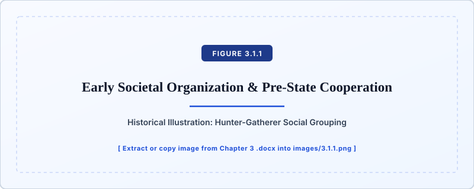
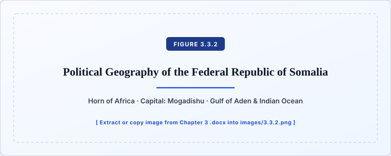
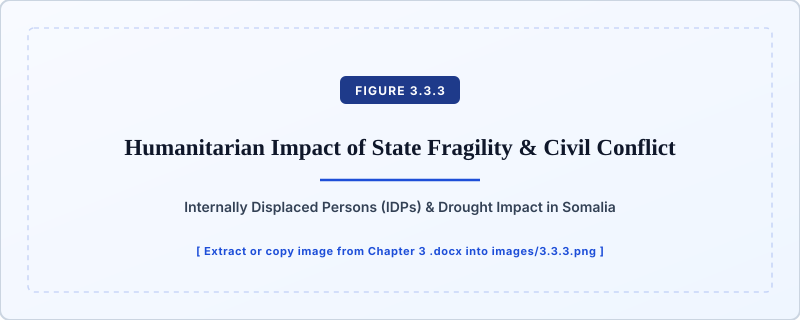

# Chapter 3: States and Regimes

## 3.1: Introduction to States

::: callout-note
### Learning Objectives

By the end of this section, you will be able to:

- Explain the historical origins of social order and **social contract** theory.
- Differentiate between the foundational concepts of **state**, **nation**, **country**, and **government**.
- Distinguish between **soft power** and **hard power**, and explain the three sources of state **legitimacy** (**traditional legitimacy**, **charismatic legitimacy**, and **rational-legal legitimacy**).
:::

### Introduction

What is a government? Is a government necessary? Why do governments exist?

There are approximately eight billion people on the planet and nearly 200 identified countries worldwide, each of which has a government running the country. A **government** is the organization, or the group of people, with the power to set rules, to manage, and to regulate a political unit. Yet the question of why most people live under a government, or in a country that has rules and societal norms, can be difficult to grasp. Why do people consent to being ruled over? The existence of nearly 200 countries for eight billion people suggests that, while daily life for the average person may be filled with myriad to-do lists and activities, political powers also influence daily life in small and big ways.

To this end, this section considers the historical formation of political power within countries and introduces several pieces of foundational terminology in the field of comparative politics.

### Social Order and the Social Contract

Let’s begin with some critical questions: Why do governments exist? Is a government necessary?

A society without government or central leadership is one that lives in **anarchy**. **Anarchy** is a situation in which there is a lack of societal structure and no established hierarchy of power or central governing authority. While many scholars have considered the phenomenon and applicability of anarchy, it has not been a norm within the communities of humans living over the past 15,000 years. Even prior to the establishment of formal governments and formalized institutions, human beings organized themselves for survival purposes. Over the course of human history, humans began to understand that survival seemed more feasible when they cooperated with one another. While they did not have established, written laws, early humans did have informal rules and norms for how they handled themselves in society. Informal leaders also sometimes guided small groups, mostly composed of family members, in their pursuit of survival (Barnes, 1924; Strayer, 1965).

Take a moment to consider your own family when you were a child. Were there rules within your household? Who was in charge? Who told you what to do and when to do it? Whether your household had many or few rules, consider now how those rules contributed to the manner in which your family worked and lived. Did rules help your family? Did you think the family leaders were legitimate? Did you follow their rules voluntarily?

Over time, the small family groupings banded together into tribes with the common goal of surviving. These tribes then formed their own rules and norms for how their group should act. Over time, the sophistication of these tribes' survival techniques increased, moving from a hunter-gatherer approach—in which humans hunted for their food and gathered fruits, berries, and other available plant life—toward farming (Strayer, 1965; Anderson, 1979).

{#fig-3-1-1 fig-alt="Historical illustration of a Kali'na hunter and gatherer."}

Approximately 12,000 years ago, developments during the Agricultural Revolution allowed humans to stay in one place for longer. Humans learned to grow crops by tilling the land and introducing early irrigation methods. With the ability to stay in one place for longer, rather than moving around constantly to hunt and gather, human groups began to aggregate in common locations. This aggregation also led to human population growth. A larger number of people living closer together led to the need for formal societal organization. To ensure successful coexistence, and ultimately survival, humans needed order. Rather than by pursuing an anarchical system, humans calculated that a strong set of rules would improve the status quo (individually and collectively), and therefore embraced mutual cooperation in a rules-based society.

This ultimately led to the development of ideas by philosophers like Thomas Hobbes, John Locke, and Jean-Jacques Rousseau to create what we now term "social contract theory" (Barnes, 1924). In short, a **social contract** is a formal or informal agreement between the rulers and those ruled in a society. Those who are ruled submit to the laws of the rulers in exchange for certain benefits.

Social contract theory developed gradually. Hobbes (1588–1679) acknowledged that all people act within their own self-interest, and in acting in their own self-interest, make calculations to ensure their survival. This selfish nature of human beings creates an unstable and dangerous state of nature. According to Hobbes, a government is therefore necessary, and beneficial, to control the masses (Hobbes, 1651/1996). Locke (1632–1704), in his *Two Treatises of Government*, took a more positive view of human nature. He argued that all people are born with "certain, unalienable" rights, which governments should protect through their political institutions and structures (Locke, 1689/1988). Rousseau (1712–1778), in *The Social Contract*, argued that society does not lend itself to equal and equitable treatment, and a government is therefore only legitimate if it comes from the consent of the people. He argued that there must be a "unified will" that takes into consideration the interests of the people for the common good (Rousseau, 1762/2002).

We observe an early form of the social contract in Ancient Greece, where elite men participated in government and representatives worked on behalf of the people. This is known as a **direct democracy**, defined as a political system in which all citizens are involved in political decision-making. This contrasts with an **indirect (representative) democracy**, defined as a political system in which the people elect representatives to serve on their behalf to make the laws and rules of society. Though Ancient Greece excluded many members of the population from decision-making processes and therefore did not have a true democracy, people did submit to the ruling class, through a type of representative leadership, in order to gain protection from the political system—a social contract (Hansen, 1999).

As a second historical example, we can consider the development of **feudalism**. **Feudalism** was a system of social order that arose out of the Middle Ages, particularly in Europe, wherein peasants (sometimes called Serfs) were forced to provide members of the upper class with their crops, goods, services, and loyalty (Strayer, 1965). The upper class, usually Nobles, would provide some level of protection to the Serfs in exchange for their products and services. Though not the ideal social contract, the Serfs were able to exchange their goods and services for some level of protection of their lives and property.

Today, we observe social contracts in almost every type of political system, democratic and non-democratic, and these social contracts can be voluntary or involuntary. A voluntary social contract is one in which the people agree to submit to the ruling class. The benefits of doing so may be as simple as military protection. In the United States, for example, citizens are expected to obey the laws of the land, as expressed (in part) through the U.S. Constitution. This is in exchange for protection of their "life, liberty, and the pursuit of happiness," as famously written in the Declaration of Independence. Though a social contract may be voluntary, it does not always mean that those who are ruled enjoy privileges like freedom of speech. Rather, the people may simply need protection from outside threats, and they may voluntarily agree to submit to the ruling class without any guarantees of other protections like civil liberties. Alternatively, an involuntary social contract is when the ruling class dominates in a given territory and demands obedience from the people. In this case, those being ruled are coerced into a social contract.

There are also implicit social contracts. For example, most U.S. citizens are born into their social contract because the 14th Amendment to the U.S. Constitution guarantees birthright citizenship (U.S. Const. amend. XIV, § 1). By being born into citizenship, Americans may never need to actualize, or act upon, their citizenship. They benefit from a system that protects their rights and liberties, even when they choose not to obey the law. In contrast, there are other U.S. citizens who are not born into this social contract, and instead go through a formal process, called **naturalization**, for citizenship. **Naturalization** is the process by which non-citizens formally become citizens of the country they reside in (USCIS, 2024). Naturalization is a long process that requires multiple steps, including but not limited to background checks, oral examinations, paperwork, and pledging allegiance to the host country in a formal ceremony. The process of naturalization is an example of a voluntary and formal social contract.

{#fig-3-1-2 fig-alt="Citizens taking the oath of allegiance during a naturalization ceremony."}

To summarize, our understanding of and need for government comes from this historical reckoning of the social contract and the drive for social order. We will now define several related, but distinct, terms that are foundational to the study of comparative politics.

### Defining Terms

One of the most frequently used words in the study of comparative politics is the word "state" (Nettl, 1968; Krasner, 1984). For many students, "state" implies a subnational government, such as states within the United States like California, Louisiana, Montana, and Rhode Island. In comparative politics, however, a **state** is a national-level group, organization, or body that administers its own legal and governmental policies within a designated region or territory. As a reminder from a term introduced in Chapter 1, a state must have **sovereignty**, which is fundamental governmental power and authority in decision-making within a given territory.

States, then, are the major political actors in global politics. The United Nations, in fact, includes 193 member-states. Outside of the comparative politics discipline, many people tend to use the terms state, country, nation, and government interchangeably. Within comparative politics, each of these terms is distinct, and each term has different implications when observing political landscapes around the world (Nettl, 1968; Krasner, 1984).

If a state is a national-level organization that administers its own legal and governmental policies within a designated region or territory, what are nations and countries? While a state relates specifically to how a designated territory operates politically through institutions (e.g., legislatures, courts, the military), a **nation** is broadly defined as a population of people joined by common culture, history, language, and/or ancestry within a designated region or territory. It is therefore possible for a nation to exist without sovereignty. A **country** is similar, and the term that most people tend to use colloquially, but this term can encompass aspects of both the nation and the state. A **country** is a nation, which may have one or more states within it. Finally, as a reminder from the introduction to this section, a **government** is the group of people in charge of running a state. The government therefore changes over time (e.g., in a democracy, the government may change after an election).

As an example to better differentiate these terms, we will briefly consider the case of Spain. Spain, meaning all of the political institutions that manage the Spanish territory, is a state. Within Spain, there are several nations with unique languages, cultures, and traditions, such as the Basques, the Catalans, and the Galicians. When we speak of Spain as a country, we include both the political institutions making up the state and the diverse nations within the Spanish territory. Finally, the leadership in power at a given time—in Spain, a prime minister and their cabinet—is the Spanish government. When a new election takes place, the government may change, but the state remains the same.

As noted above, one of the crucially important characteristics of a state is its ability to independently organize its policies and goals (Hinsley, 1969; Krasner, 1993). Sovereignty is not only fundamental governmental power to coerce, but it also involves the ability to manage the state's affairs independently from outside interference (external sovereignty) and the ability to deflect internal resistance (internal sovereignty). If a state does not have the ability to manage its own affairs and issues, it will not be able to maintain power.

**Power**, broadly defined, is the ability to get others to do what you want them to do. **Soft power** means being able to get others to do what you want them to do using the methods of persuasion and attraction, such as through diplomacy or cultural influence (Nye, 2011). **Hard power**, in contrast, is the ability to get others to do what you want using physical, military might and/or aggressive economic measures. While hard power aims to coerce, soft power aims to persuade, and both types of power hold critical places in the world of politics.

![Figure 3.1.6: On the left, a photo of the United Nations General Assembly Hall. Negotiating for ideal political terms is an example of soft power. On the right, a photo of a test launch of an LGM-25C Titan II Intercontinental Ballistic Missile at Vandenberg Air Force Base in the United States, 1975. Launching a missile would be an example of trying to exercise hard power. (Sources: From left to right, United Nations General Assembly Hall by Patrick Gruban is licensed under CC BY-SA 2.0; An LGM-25C Titan II missile is launched at Vandenberg Air Force Base by the U.S. Air Force is licensed under Public Domain - US)](images/3.1.6.svg){#fig-3-1-6 fig-alt="Comparison of diplomacy in the UN General Assembly Hall (soft power) and an ICBM launch (hard power)."}

Whether a state has power, and whether it can operate effectively, depends on its authority and legitimacy (Weber, 1978). **Authority** is power that is recognized as legitimate and rightful. **Legitimacy** is the state’s ability to establish itself as a valid power over its citizens. If we put these two terms together, a state is legitimate in its operations if it has the authority to make decisions and carry out its policy goals.

A state's leaders (i.e., its government) can garner legitimacy through multiple means (Weber, 1978; Lipset, 1959). **Traditional legitimacy** occurs when states have the authority to lead based on historical precedent. For example, the legitimacy of a king may stem from the passing down of the throne through one family over time. **Charismatic legitimacy** occurs when citizens follow the rules of a state based on the charisma and personality of the current leader. **Rational-legal legitimacy** occurs when states derive their authority through firmly established laws, rules, regulations, and procedures. This type of legitimacy often derives from a state's **constitution**, which is a written document describing the basic principles and laws of the state.

Each of these forms of legitimacy, especially when taken together, can enhance a state’s ability to function. If, for instance, there is a written and adopted constitution, and that document has been transparently drafted and considered by representatives of a state, individuals will know what the rules are within their state (rational-legal legitimacy). In time, as laws and norms are followed and accepted, this process establishes a historical precedent that individuals are more likely to accept (traditional legitimacy). Finally, if there happens to be an especially appealing or inspirational leader, that person may be able to garner further support from the people to deepen a state’s legitimacy (charismatic legitimacy).

Keeping in mind the differences in the terms government, state, country, and nation, the next section will provide two further distinctions. First, we will consider how to differentiate "weak" versus "strong" states. Second, we will start to consider one additional foundational term, political regime, which we will expand on in Chapter 4 and Chapter 5.

## 3.2: The Modern State and Regime Types

::: callout-note
### Learning Objectives

By the end of this section, you will be able to:

- Distinguish between **strong states**, **weak states**, and **failed states** using the concept of state **capacity**.
- Define **political regime** and contrast **democracy** with **non-democracy** (including **personalist regime** and **military regime**).
- Explain how a **regime transition** occurs.
:::

### Introduction

The rise of the so-called "modern state" is usually attributed to the end of the European Middle Ages, wherein states were critical to the organization and survival of certain societies (Anderson, 1979; Tilly, 1990; Ertman, 1997; Spruyt, 1994). Being a member of a state brought benefits to those included. Having a recognized state meant there was a recognized authority by which states could trade and do business with each other. Trade prompted economic development, which further solidified trading relationships. With economic development, states were able to pursue technological innovations. The advent of trade enabled states to improve the way day-to-day activities were run, and it enabled states to build further military power. Advances in technology helped European states improve engineering, map-making, mathematics, and weapons development. All of these advances contributed to some semblance of political stability for a state's inhabitants. When protected by a recognized, and at least partially unified, state, ordinary people had greater chances for survival.

As described in the previous section, not all social contracts and state authority are created equal; in fact, there is great variation in the way states manifest in different regions and under different ideological perspectives. This section considers several key factors that comparativists use to compare states.

### State Strength

The first key factor on which to compare states is state strength (Migdal, 1988). All states grapple with the balance between how much freedom the state will grant its citizens and how much authority the state will wield. This contributes to a variety of political outcomes. Some states are powerful, strong, effective, and stable. Other states are disorganized, chaotic, weak, and unstable. How can we tell the difference between strong and weak states?

**Strong states** are those which are able to work their political agendas effectively and to make sure basic political tasks are completed (Herbst, 2000; Weiss, 1998). Strong states are able to defend their territory and interests, collect taxes from their citizens, enforce laws, manage their economies, and promote civil and political stability within their domain. Regardless of where authority is derived, the state has legitimacy to act because the citizens have accepted the terms of the social contract.

**Weak states** are those which are unable to perform basic political tasks or complete their political agendas effectively. Weak states are typically unable to defend their territories and interests. They do not have enough legitimacy, or are not institutionalized well enough, to collect taxes, enforce their laws, and/or manage their economies effectively. Weak states may also struggle to ensure domestic stability, likely because they lack the legitimacy and authority to act on their constituents.

**Failed states** are those in which the structures of the state are so weak that the state breaks down (Zartman, 1995). A failed, or failing, state does not necessarily imply a situation of anarchy. While a central authority may be unable to effectively control its territory in a failed state, there may remain some semblance of government intact and other societal structures, such as markets, may still function.

These definitions of varying state strength rely on the concept of state **capacity** (Herbst, 2000; Evans et al., 1985). **Capacity** is the ability of a state to use its power, as derived through authority and legitimacy, to get things done and promote its own interests. A state's strength therefore also implicitly relies on our previously-defined term of sovereignty, fundamental governmental power and authority in decision-making within a given territory. A state with low capacity or impediments to its sovereignty is weak; a state with high capacity and no impediments to its sovereignty is strong.

### Political Regime

The second key factor on which to compare states is political regime. A **political regime** is the set of rules that structures access to political power within a state, which is usually institutionalized through a state's constitution (Krasner, 1984; March & Olson, 1984). A state's political regime has implications for the ways in which a state chooses to wield its power to enforce laws, rules, and norms of political life.

We typically separate political regimes into two broad types: democracies and non-democracies. A **democracy** is a political regime in which the supreme power of government is vested in the people (Dahl, 1989). We will discuss democratic institutions, systems of democracy, and democratic consolidation in Chapter 4. A **non-democracy** is a political regime that denies citizens meaningful institutional channels for making choices about their collective well-being. Non-democracies are often referred to as "dictatorships" or "authoritarian regimes" or "autocracies." We will discuss non-democratic strategies for staying in power, types of non-democracies, and democratic backsliding (toward a non-democratic regime) in Chapter 5.

As a brief preview and to clarify the differences between democratic and non-democratic regimes, we can compare the ways in which the rules structure access to political power within a state. In a democracy, rulers come to power through free and fair elections; in a non-democracy, rulers do not come to power through free and fair elections.

As one example of a non-democracy, we can consider a **personalist regime**, a type of political regime in which power lies with a single, charismatic, and all powerful person who drives all actions of the state (typically referred to as a "dictator") (Linz, 2000; Geddes et al., 2018). While non-democracies can range in the extent to which the state intervenes in the private lives of citizens, most non-democracies do not permit independent media or protect civil liberties like freedom of speech and association. A current example of a personalist regime is North Korea.

The current Supreme Leader of North Korea is Kim Jong-Un, who has served since 2011. Kim Jong-Un took over the title of Supreme Leader after the death of his father, Kim Jong-Il. Similarly, Kim Jong-Il took over the title of Supreme Leader in 1994 after the death of his father, Kim Il-Sung. The people of North Korea do not elect their Supreme Leader; rather, the method to access political power is through dynastic succession (i.e., power is passed down within the Kim family). The state's legitimacy therefore relies on charismatic legitimacy stemming from the Kim family, which enjoys a **cult of personality**. A **cult of personality** occurs when a state leverages all aspects of a leader’s real and exaggerated traits to solidify the leader’s power (Geddes et al., 2018). In North Korea, the media promotes propaganda to endow its leader with divine-like status.

{#fig-3-2-1 fig-alt="Portrait of Kim Jong-Un of North Korea."}

As a second example of a non-democracy, is a **military regime**, a type of political regime characterized by military elites running the government, also referred to as a junta (Linz, 2000; Geddes et al., 2018). Similar to the personalist regime example, within a military regime, the leaders do not come to power through elections. In many cases, rather, a junta initially forms as resistance to or rebellion against an existing government, then gains power through a military-led **coup d'état**. A **coup d'état** (often simply called "coup") is an attempt to abruptly, unlawfully, and sometimes violently seize power from an existing government. In Myanmar in 2021, for instance, the military (Tatmadaw) seized control, overthrowing a democratically-elected government (Egreteau, 2022). After a parliamentary election in November 2020 that resulted in a decrease in the number of military-aligned political party seats, Myanmar's military alleged election fraud and requested that the government delay the opening session of parliament. The government rejected this request and, in response, the military seized power, detained those who had won the election, declared a state of emergency, and handed control of all branches of government to Senior General Min Aung Hlaing as junta leader (with the official title of Chairman of the State Administration Council).

In each of the two examples above, the commonality that distinguishes non-democratic from democratic regimes is that rulers come to power through means other than free and fair elections.

It is important to note that political regimes are not fixed. A **regime transition** occurs when there is a change in political regime (e.g., from democracy to non-democracy, from non-democracy to democracy, or from one type of non-democracy to another) (Huntington, 1991; O'Donnell & Schmitter, 1986).

Consider the example of the rise of Adolf Hitler in Germany during the 1920s. Following World War I, a weak democracy was installed in Germany called the Weimar Republic, but the state suffered from a number of problems. The terms of the Treaty of Versailles, the peace treaty that formally ended World War I, put Germany into dire social and economic straits. Germany was forced to pay high reparations, which left the German people impoverished. High unemployment, high inflation, and general discontent made it difficult for the Weimar Republic to enforce its political agenda. In the midst of these circumstances, Hitler crafted a cult of personality to rally many Germans against the Weimar Republic. Through his use of manipulation and incendiary speech, Hitler was appointed as Chancellor of Germany in 1933. He (and the Nazi Party) effectively abolished the Weimar Constitution through decrees and laws that consolidated his power while eroding the rights and liberties of the German people, turning Germany into a non-democratic regime. At the end of World War II, and after Hitler's death, Germany experienced another regime transition, but this time from non-democracy to democracy.

While comparativists study regime transitions, regime types, and state strength, they also study states by considering many aspects of political institutions, political and cultural identity, political economy, and political violence. We will discuss these topics in detail in subsequent chapters.

## 3.3: Comparative Case Study - Botswana and Somalia

### Introduction

Why compare and contrast Botswana and Somalia when discussing the state? This selection provides an example of a Most Similar Systems Design (MSSD). As reviewed in Chapter 2, the MSSD requires comparativists to consider at least two cases that are similar in terms of underlying conditions (control variables), yet have an outcome of interest (the dependent variable) that differs. Botswana and Somalia have a number of geographic and historical circumstances in common, and yet the resulting political outcomes have been very different. For example, even though both countries were colonized and deeply affected by imperialism, Botswana is a relatively stable democracy with a growing economy (Herbst, 2000; Jackson, 1987). In contrast, Somalia is considered a failed state, where the government in the capital city of Mogadishu barely exercises any control within the country. The primary difference between these two countries has been their form of legitimate authority, where the government of Botswana is recognized by its people and the international community. This is not the case in Somalia, where rebel groups refuse to recognize the authority of the government. In addition, external actors intervene in Somalia, further muddling the picture. Botswana and Somalia, while both former colonies, have ended up with quite different destinies.

### Botswana

{#fig-3-3-1 fig-alt="Map of Botswana showing capital Gaborone, Kalahari Desert, Okavango Delta, and neighboring countries."}

- Full Country Name: Botswana, Republic of Botswana
- Head(s) of State: President
- Government: Parliamentary Republic
- Official Languages: Setswana, English
- Economic System: Market-Oriented Economy
- Location: Southern Africa
- Capital: Gaborone
- Total land size: 224,610 sq. miles
- Population: 2.5 million (2025)
- GDP: \$19.401 billion (2024)
- GDP per capita: \$18,100 (2024)
- Currency: Pula

The Republic of Botswana is located in Southern Africa, and it is a landlocked country. Botswana is bordered by South Africa to the south, Namibia to the northwest, and Zimbabwe to the northeast. Botswana has a long history, and is credited with perhaps being the "birthplace" of all modern humans dating back over 200,000 years. Much of what is known about the ancient Botswana region is derived from archeological and anthropological research, which has traced evidence of human civilization through ancient tools, cave drawings, and evidence of farming practices that existed through the region over time. Although there is robust evidence of the region’s population adopting agricultural practices and having tribal norms and values that were followed, the first actual written records of life in Botswana did not exist until the 1820s.

Botswana was one of many African countries affected by the **Scramble for Africa**, sometimes also called the Conquest of Africa, wherein Western European powers attempted to control and colonize all parts of Africa (Pakenham, 1991; Acemoglu et al., 2003). The Scramble for Africa occurred between the years of 1880 to 1914, with countries like Britain, France, Belgium, Portugal, Spain, and Italy invading and colonizing much of Africa. Botswana was dominated by Britain. Under British rule, the region of Botswana was called the Bechuanaland Protectorate.

Part of the reason the region was called a protectorate was that Britain annexed, or took over, the region on the basis that they were "protecting" the main tribes from the Boers. **Annexation** is the incorporation by a state of another state's territory. The Boers were descendants of Dutch colonists in Southern Africa, and would frequently attempt to take over the territory of Botswana tribes. To protect their economic and military interests in Botswana, Britain permitted the Bechuanaland Protectorate to operate under its own leadership and rules, but supplied resources to protect the region from the Boers. A **protectorate** is defined as an area or nation that is managed, possessed, controlled, and protected by a different state. The area or nation is dependent in that it relies on the security provided by another state, but is still allowed, to some extent, to dictate its own local politics and activities (Parsons, 1993; Acemoglu et al., 2003).

At the beginning of the 20th century, more and more power started being shared with the various tribes and councils within Southern Africa. Various proclamations enabled tribal powers to have some level of power over how they conducted themselves. Nevertheless, it was not until 1964 that Britain allowed Botswana to declare its independence. Botswana was able to hold its first elections in 1966, following the creation of its own constitution in 1965.

Today, Botswana is considered Africa’s oldest and most stable democracy, though it is not without some issues (which will be discussed below). Botswana’s Constitution provides the supreme law of the land and the basis for rule. There are components of Botswana’s constitution that seek to protect the citizens of Botswana by providing for certain **civil liberties**. **Civil liberties** are individual rights that are protected by law to ensure the government does not unreasonably interfere (e.g., freedom of speech, freedom of religion, freedom of assembly). Botswana is a parliamentary republic, which is a system of government where the executive branch is given its powers by the legislative branch. In Botswana’s case, the president serves as both the head of state and head of government, and is elected by, and held accountable by, Botswana’s Parliament.

Although Botswana has three branches of government with defined powers according to their constitution, and even though free and fair elections do occur, there is some question as to the true level of freedom within Botswana. The Freedom in the World Index categorizes Botswana’s democracy as free, but a number of global indexes for democracy, including the Democracy Index, categorize Botswana as having a flawed democracy (Economist Intelligence Unit, 2024; Freedom House, 2024).

One area of concern among some analysts is Botswana’s party system. Botswana has been dominated by single party rule since independence, which may be an indication that there is a lack of fair competition (Acemoglu et al., 2003; Sebudubudu & Osei-Hwedie, 2005). A second area of concern relates to perceived threats to Botswana’s freedom of speech and freedom of press. A third cautionary issue is how Botswana’s government treats migrants, refugees, and the LGBTQIA+ community; all of these groups face constant discrimination under the law.

While Botswana’s current situation shows a number of democratic flaws, Botswana still has one of the oldest, most stable democracies in Africa. In addition, according to most indexes, Botswana is one of the least corrupt democracies in Africa, earning it the nickname of the "African Exception." Why has Botswana been reasonably successful in comparison to other African states?

One explanation is cultural (Lewis, 2020; Putnam, 1993). At the time of Botswana’s independence in the mid-1960s, life for the people of Botswana was fairly traditional and undisturbed. In addition, prior to the move to formal independence vis-a-vis the creation of a government and the adoption of a constitution, the loose agreements with Britain within the protectorate structure allowed the region to operate with its own leaders within tribes. A saying in Setswana seems to capture this sentiment prior to the adoption of a constitution: *"Kgosi ke Kgosi ka batho,"* meaning "A chief is a chief by the will of the people" (Lewis, 2020).

Another explanation is resource-based (North, 1981; Olson, 2000). The British lacked interests in Botswana's geographical resources. It has been said that a government official in Botswana quipped, “The British left us with nothing!” He then paused, thoughtfully, and added, “On the other hand, the British left us with nothing” (Lewis, 2020). For democratic development, it may have been helpful that the British left Botswana alone, allowing the state to largely develop its own institutions and governmental practices.

### Somalia

{#fig-3-3-2 fig-alt="Map of Somalia showing Mogadishu, Gulf of Aden, Indian Ocean, and neighboring countries."}

- Full Country Name: Somalia, Federal Republic of Somalia
- Head(s) of State: President, Prime Minister
- Government: Federal parliamentary republic
- Official Languages: Somali, Arabic
- Economic System: Informal
- Location: Eastern Africa
- Capital: Mogadishu
- Total land size: 246,201 sq. miles
- Population: 20.3 million (2025)
- GDP: \$12.109 billion (2024)
- GDP per capita: \$1,400 (2025)
- Currency: Somali Shilling

Somalia is a country located in Eastern Africa, the Horn of Africa, and bordered by Kenya, Ethiopia, and Djibouti. Like Botswana, Somalia has a long history. Somalia was a stopping point that enabled profitable trade to occur between what is now the Middle East, connecting trading pathways with India and China. In the 9th century, Islam was introduced to the region of present-day Somalia by Muslims fleeing persecution. Over time, Islam grew to be the main religion of Somalia (Lewis, 2002).

Somalia, like Botswana, was a target within the Scramble for Africa, though the influence of colonial powers differed in Somalia (Lewis, 2002). Botswana had been under British control, while Somalia was partially dominated by Britain, and partially dominated by Italy. The two colonial powers fought for control over Somali territory, to the detriment of the Somalians.

After years of dispute in the international community, including between Britain and Italy, Somalia formed the Somali Republic in 1961. In 1969, the President Abdirashid Ali Shermarke was assassinated during a military coup d'état. The leader of the military at that time, Major General Mohamed Siad Barre, initiated the coup, became the leader of the Supreme Revolutionary Council (SRC), and controlled the country. In 1991, in the face of increasingly authoritarian rules, Barre’s rule came to an end through the combined efforts of different clans who opposed Barre’s rule. Together, the clans were able to oust Barre (Lewis, 2002). The rest of Somalia became a power vacuum; a civil war began where the clans that had ousted Barre fought for dominance. During the civil war, many political scientists began calling Somalia a failed state because there was no dominant authority able to reign supreme (Herbst, 2000; Rotberg, 2004).

Finally, in 2012, the Federal Government of Somalia was formed, which has been the most permanent central government authority in place since 1991 (Freedom House, 2024). This government utilizes a federal parliamentary republic, though it is not a democracy and Freedom House categorizes Somalia as "not free." When considering the impact of ongoing political conflict combined with drought conditions, millions of Somalians have been displaced.

{#fig-3-3-3 fig-alt="Internally displaced families in Somalia."}

## 3.4: References

Acemoglu, D., Johnson, S., & Robinson, J. A. (2003). An African success story: Botswana. In D. Rodrik (Ed.), *In Search of Prosperity: Analytic Narratives on Economic Growth* (pp. 80–119). Princeton University Press.

Amnesty International. (2024). *Botswana 2023/24*. Amnesty International. <https://www.amnesty.org>

Anderson, P. (1979). *Lineages of the absolutist state*. Verso Editions.

Barnes, H. E. (1924). Theories of the origin of the state in classical political philosophy. *The Monist*, 34(1).

Dahl, R. A. (1989). *Democracy and its critics*. Yale University Press.

Economist Intelligence Unit. (2024). *Democracy index 2024*. Economist Intelligence Unit.

Egreteau, R. (2022). *Crafting Parliament in Myanmar's disciplined democracy (2011–2021)*. Oxford University Press.

Ertman, T. (1997). *Birth of the leviathan*. Cambridge University Press.

Evans, P. B., Rueschemeyer, D., & Skocpol, T. (1985). *Bringing the state back in*. Cambridge University Press.

Freedom House. (2024). *Freedom in the world 2024: Botswana*. Freedom House. <https://freedomhouse.org>

Geddes, B., Wright, J., & Frantz, E. (2018). *How dictatorships work: Power, personalization, and collapse*. Cambridge University Press.

Hansen, M. H. (1999). *The Athenian democracy in the age of Demosthenes*. University of Oklahoma Press.

Herbst, J. (2000). *States and power in Africa: Comparative lessons in authority and control*. Princeton University Press.

Hobbes, T. (1996). *Leviathan* (R. Tuck, Ed.). Cambridge University Press. (Original work published 1651)

Huntington, S. P. (1991). *The third wave: Democratization in the late twentieth century*. University of Oklahoma Press.

Krasner, S. D. (1984). Approaches to the state: Alternative conceptions and historical dynamics. *Comparative Politics*, 16(2), 223–246.

Lewis, I. M. (2002). *A modern history of the Somali: Nation and state in the Horn of Africa* (4th ed.). Boydell & Brewer.

Linz, J. J. (2000). *Totalitarian and authoritarian regimes*. Lynne Rienner Publishers.

Lipset, S. M. (1959). Some social requisites of democracy: Economic development and political legitimacy. *American Political Science Review*, 53(1), 69–105.

Locke, J. (1988). *Two treatises of government* (P. Laslett, Ed.). Cambridge University Press. (Original work published 1689)

Migdal, J. S. (1988). *Strong societies and weak states: State-society relations and state capabilities in the Third World*. Princeton University Press.

Nettl, J. P. (1968). The state as a conceptual variable. *World Politics*, 20(4), 559–592.

Nye, J. S. (2011). *The future of power*. Public Affairs.

Rousseau, J.-J. (2002). *The social contract and the first and second discourses* (S. H. Dunn, Ed. & Trans.). Yale University Press. (Original work published 1762)

Weber, M. (1978). *Economy and society*. University of California Press.

Zartman, I. W. (1995). *Collapsed states: The disintegration and restoration of legitimate authority*. Lynne Rienner Publishers.

## 3.5: Student Resources

### Key Terms

- **Anarchy**: a situation in which there is a lack of societal structure and no established hierarchy of power or central governing authority.
- **Annexation**: the incorporation by a state of another state's territory.
- **Authority**: power that is recognized as legitimate and rightful.
- **Capacity** is the ability of a state to use its power, as derived through authority and legitimacy, to get things done and promote its own interests.
- **Charismatic legitimacy**: a type of legitimacy in which citizens follow the rules of a state based on the charisma and personality of the current leader.
- **Civil liberties**: individual rights that are protected by law to ensure the government does not unreasonably interfere (e.g., freedom of speech).
- **Constitution**: a written document describing the basic principles and laws of the state.
- **Country**: a nation, which may have one or more states within it.
- **Coup d'état**: an attempt to abruptly, unlawfully, and sometimes violently seize power from an existing government.
- **Cult of personality**: occurs when a state leverages all aspects of a leader’s real and exaggerated traits to solidify the leader’s power.
- **Democracy**: a political regime in which the supreme power of government is vested in the people.
- **Direct democracy**: a type of democracy in which all citizens are involved in political decision-making.
- **Failed states**: those in which the structures of the state are so weak that the state breaks down.
- **Feudalism**: a system of social order that arose out of the Middle Ages, particularly in Europe, wherein peasants (sometimes called Serfs) were forced to provide members of the upper class with their crops, goods, services, and loyalty.
- **Government**: the organization, or the group of people, with the power to set rules, to manage, and to regulate a political unit (e.g., a state).
- **Hard power**: the ability to get others to do what you want using physical, military might and/or aggressive economic measures.
- **Indirect (representative) democracy**: a political system in which the people elect representatives to serve on their behalf to make the laws and rules of society.
- **Legitimacy**: the state’s ability to establish itself as a valid power over its citizens.
- **Military regime**: a type of political regime characterized by military elites, rather than civilians, running the government.
- **Nation**: a population of people joined by common culture, history, language, and ancestry within a designated region or territory.
- **Naturalization**: the process by which non-citizens formally become citizens of the country they reside in.
- **Non-democracy**: a political regime that denies citizens meaningful institutional channels for making choices about their collective well-being.
- **Personalist regime**: a type of political regime in which power lies with a single, charismatic, and all powerful person who drives all actions of the state.
- **Political regime**: a set of rules that structures access to political power within a state, usually institutionalized through a constitution.
- **Power**: the ability to get others to do what you want them to do.
- **Protectorate**: an area or nation that is managed, possessed, controlled, and protected by a different state.
- **Rational-legal legitimacy**: a type of legitimacy that exists when states derive their authority through firmly established laws, rules, regulations, and procedures (e.g., through a constitution).
- **Regime transition**: when there is a change in political regime (e.g., from democracy to non-democracy, from non-democracy to democracy, or from one type of non-democracy to another).
- **Scramble for Africa**: when Western European powers attempted to control and colonize all parts of Africa between 1880 and 1914.
- **Social contract**: a formal or informal agreement between the rulers and those ruled in a society.
- **Soft power** is the ability to get others to do what you want them to do using the methods of persuasion or attraction, such as through diplomacy or cultural influence.
- **Sovereignty** is fundamental governmental power and authority in decision-making within a given territory.
- **State** is a national-level group, organization, or body which administers its own legal and governmental policies within a designated region or territory.
- **Strong states** are those that are able to work their political agendas effectively and to make sure basic political tasks are completed.
- **Traditional legitimacy** is a type of legitimacy that exists when states have the authority to lead based on historical precedent.
- **Weak states** are those which are unable to perform basic political tasks or complete their political agendas effectively.

### Summary

#### Section 3.1: Introduction to States

A state is a national-level group, organization, or body that administers its own legal and governmental policies within a designated region or territory. There has been ample research regarding the formation of states globally, and it is important to be able to distinguish between the terms "government," "state," "country," "nation," and "regime." Social contract theory is a critical concept in considering state formation because it lays the foundations for why individuals might enter into a social contract with government powers. Ideally, the social contract is the mechanism through which individuals surrender some of their individual rights for protections provided by the governmental powers.

#### Section 3.2: The Modern State and Regime Types

Social contracts and state authority are not the same everywhere. Modern states can fall into the categories of strong and weak states. Strong states are those which are able to work their political agendas effectively and to make sure basic political tasks are completed. Weak states are those which are unable to perform basic political tasks and unable to complete their political agendas effectively. The difference between strong and weak states can often be delineated through calculating a state’s political capacity. Political capacity is the ability of a state to use its power, as derived through authority and legitimacy, to get things done and promote its own interests. A political regime is a set of rules that structures access to political power within a state, usually institutionalized through a constitution. A state may fall into one of many types of political regime, which can fall on a spectrum of democracies to non-democracies.

#### Section 3.3: Comparative Case Study – States and the Stateless: Botswana and Somalia

Although Botswana and Somalia have a number of geographic and historical circumstances in common, the resulting political outcomes differ. Botswana is considered to have one of the oldest and most stable democracies in Africa, while Somalia does not have a consolidated government authority that has widespread approval of the population. Botswana is recognized as a functional state, whereas Somalia has occasionally been considered stateless, a failed state, or a failing state. One of the features that may have been pivotal in the political outcomes of both Botswana and Somalia is the extent to which external powers interfered with their establishment of government authority. Botswana, though formally annexed by Britain, was able to establish its own government, whereas Somalia was considered to be of too much geopolitical importance to be supported in its pathway to eventual independence.

### Review Questions

1.  Which of the following influential thinkers was NOT a social contractarian?
    a.  Thomas Hobbes
    b.  John Locke
    c.  King George
    d.  Jean-Jacques Rousseau
2.  What is one way to gauge the difference between a strong and weak state?
    a.  military strength
    b.  economic strength
    c.  political capacity
    d.  regime type
3.  What is the name of the governing body within a military regime that has a small group of military officers in charge?
    a.  democracy
    b.  aristocracy
    c.  anarchy
    d.  junta
4.  What do we term a state that has structures so weak that the state breaks down?
    a.  failed state
    b.  strong state
    c.  institutionalized state
    d.  weak state
5.  What do we call the change from a democracy to a dictatorship, or from a dictatorship to a democracy?
    a.  weak state
    b.  strong state
    c.  regime transition
    d.  consolidated government

Answers: 1.c, 2.c, 3.d., 4.a, 5.c

### Critical Thinking Questions

1.  What is the state and what is its relationship to the social contract? Consider the various ways in which the social contract can manifest to contribute to varying state outcomes.
2.  How is the strength of a state derived? How can we tell the difference between weak and strong states? Provide examples.
3.  Are some societies better off without the state? Are there circumstances where the formation of a state would be detrimental? Describe these circumstances.

### Suggestions for Further Study

#### Websites

- [Our World in Data](https://ourworldindata.org/)
- [The World Bank, World Development Indicators](https://databank.worldbank.org/source/world-development-indicators)

#### Journal Articles

- Almond, G. A. (1988). “The Return of the State,” and replies by Eric A. Nordlinger, Theodore J. Lowi and Sergio Fabbrini. *American Political Science Review*, 82, 875–901.
- Krasner, S. D. (1984). “Approaches to the State: Alternative Conceptions and Historical Dynamics.” *Comparative Politics*, 16, 223–246.

#### Books

- Carnoy, M. (1984). *Political Theory and the State*. Princeton University Press.
- Olson, M. (2000). *Power and Prosperity*. Basic Books.
- Putnam, R. (1993). *Making Democracy Work*. Princeton University Press.
- Spruyt, H. (1994). *The Sovereign State and Its Competitors*. Princeton University Press.
