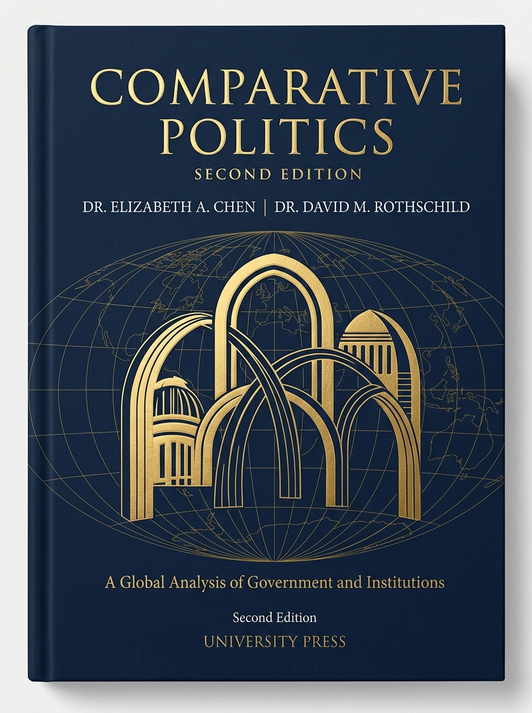

# Welcome to Comparative Politics {.unnumbered}

::: {.book-hero}
::: {.hero-content}

<i class="bi bi-mortarboard-fill" aria-hidden="true"></i> Open Educational Resource • 2nd Edition

Comparative Politics: A Global Analysis

Exploring Government, Institutions, and Societies Across the World

By <strong>Norah Jones, Ph.D.</strong> • Contributing Scholars in Comparative Politics

  <a href="01.html" class="btn-hero-primary"><i class="bi bi-book-half" aria-hidden="true"></i> Start Reading: Chapter 1</a>
  <a href="#curriculum-overview" class="btn-hero-secondary"><i class="bi bi-list-ul" aria-hidden="true"></i> Explore Curriculum</a>

:::

::: {.hero-cover}

:::
:::

::: {.stats-strip}
::: {.stat-card}

12

Core Chapters

:::

::: {.stat-card}

50+

Global Case Studies

:::

::: {.stat-card}

100%

Open Access (CC-BY)

:::

::: {.stat-card}

Interactive

Self Assessments

:::
:::

## About This Digital Edition {.unnumbered}

Welcome to the second edition of **Comparative Politics**. Designed as a comprehensive, open-access textbook for undergraduate students and scholars, this work bridges classical political philosophy with cutting-edge empirical research in global governance.

Why do some democratic institutions endure through crisis while others backslide into authoritarianism? How do distinct electoral systems shape policy outcomes, social safety nets, and economic equality? Rather than examining nations in isolation, this volume equips you with systematic comparative methodologies to analyze political behavior and institutional structures across cultures, continents, and historical eras.

::: {.callout-note}
### Key Pedagogical Framework

This text employs three complementary analytical dimensions throughout every chapter:

1. **Cross-National Analysis:** Large-$N$ comparative inquiries evaluating macro patterns across dozens of sovereign states (e.g., electoral systems vs. voter turnout).
2. **Area Studies & In-Depth Case Studies:** Context-rich investigations of specific political cultures, regional dynamics, and historical paths across the Americas, Europe, Africa, Asia, and the Middle East.
3. **Subnational Analysis:** Within-country comparisons exploring disparities across federal states, provinces, and municipal governance.
:::

## Curriculum & Chapter Directory {#curriculum-overview .unnumbered}

Browse the volume’s chapters below to begin your inquiry:

::: {.chapters-grid}

::: {.chapter-box}
::: {.chapter-top}
Chapter 1
<h3 class="chapter-heading">Why Study Comparative Politics?</h3>

Introduction to the field, distinction between political subfields, the logic of comparison, and fundamental analytical lenses.

:::
::: {.chapter-footer}
⏱ ~18 min read
<a href="01.html" class="chapter-link" aria-label="Read Chapter 1: Why Study Comparative Politics?">Read Chapter <i class="bi bi-arrow-right" aria-hidden="true"></i></a>
:::
:::

::: {.chapter-box}
::: {.chapter-top}
Chapter 2
<h3 class="chapter-heading">The State & Sovereign Authority</h3>

The origin of the modern state, Weberian legitimacy, state capacity, weak and failed states, and the challenges of globalization.

:::
::: {.chapter-footer}
Forthcoming
<i class="bi bi-lock-fill" aria-hidden="true"></i> Coming Soon
:::
:::

::: {.chapter-box}
::: {.chapter-top}
Chapter 3
<h3 class="chapter-heading">Democratic Regimes & Institutions</h3>

Parliamentary, presidential, and semi-presidential models. Electoral laws, voting systems, and institutional checks and balances.

:::
::: {.chapter-footer}
Forthcoming
<i class="bi bi-lock-fill" aria-hidden="true"></i> Coming Soon
:::
:::

::: {.chapter-box}
::: {.chapter-top}
Chapter 4
<h3 class="chapter-heading">Authoritarianism & Hybrid Regimes</h3>

Totalitarian regimes, competitive authoritarian systems, monarchies, and modern mechanisms of political co-optation and control.

:::
::: {.chapter-footer}
Forthcoming
<i class="bi bi-lock-fill" aria-hidden="true"></i> Coming Soon
:::
:::

:::

## Interactive Features in This Textbook {.unnumbered}

This textbook is optimized for active learning on modern screens:

* **Real-Time Reading Progress:** An unobtrusive progress indicator tracks your scroll position across every chapter.
* **Inline Self-Assessments:** Expandable knowledge-check cards allow students to test conceptual retention before exams.
* **Rich Figure Commentary:** Comprehensive visual collages with detailed alt text and academic citations.

::: {.callout-tip}
### Suggested Citation (APA 7th Edition)
Jones, N. (2026). *Comparative Politics: A Global Analysis of Government, Institutions, and Societies* (2nd ed.). Open Education Press. <https://doi.org/10.1000/comp-pol-2e>
:::
