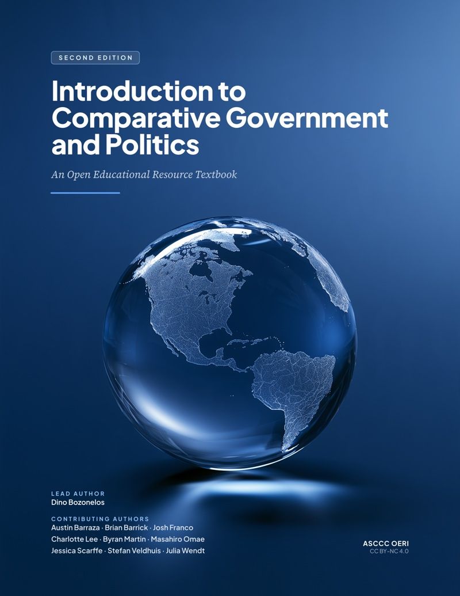

# Preface & Course Overview {.unnumbered}

```{=html}
<div class="book-hero">
  <div class="hero-content">
    <div class="hero-badge">Second Edition · Open Educational Resource</div>
    <h2 class="hero-title" style="border:none; margin:0 0 0.5rem 0; padding:0; color:#ffffff;">Introduction to Comparative Government and Politics</h2>
    <div class="hero-subtitle">An Open Educational Resource Textbook</div>
    <div class="hero-author">
      <strong>Lead Author:</strong> Dino Bozonelos<br>
      <strong>Contributing Authors:</strong> Austin Barraza · Brian Barrick · Josh Franco · Charlotte Lee · Byran Martin · Masahiro Omae · Jessica Scarffe · Stefan Veldhuis · Julia Wendt
    </div>
    <div class="hero-actions">
      <a href="chapter-01.html" class="btn-hero-primary">Start Reading &rarr;</a>
      <a href="#curricular-roadmap" class="btn-hero-secondary">Course Roadmap</a>
    </div>
  </div>
  <div class="hero-cover">
    
  </div>
</div>
```

## Welcome to the Second Edition

Welcome to ***Introduction to Comparative Government and Politics* (2nd Edition)**. This textbook is designed as a foundational, accessible, and comprehensive introduction to the field of comparative politics for undergraduate students and transfer pathways (aligned with C-ID POLS 130).

Comparative politics is the systematic study and comparison of the world's political systems. Rather than viewing domestic political phenomena in isolation, this subfield equips students with the empirical tools to compare institutions, leadership styles, regime trajectories, and public policies across diverse geographic, historical, and cultural contexts.

### What’s New in the Second Edition?

- **Refined Methodological Core:** Upfront, step-by-step guidance on scientific inference, qualitative and quantitative logic, and Mill’s Methods of Agreement and Difference.
- **Embedded Comparative Case Studies:** Paired, real-world comparative case studies (such as the comparative analysis of Botswana and Somalia in Chapter 3) that put theoretical frameworks directly into empirical practice.
- **Contemporary Global Data:** Updated political timelines, democratic index metrics, electoral results, and political economy indicators through 2024–2026.
- **Multimodal Audio Integration:** Synchronized chapter audio episodes hosted on Spotify with timestamped listening guides for auditory and commuting learners.
- **Accessible Design:** Enhanced semantic markup, WCAG 2.1 AAA accessible contrast, screen-reader optimized descriptions, and responsive mobile-ready typography.

---

## Pedagogical Structure

Each chapter in this text is organized around a consistent active-learning framework:

1. **Chapter Learning Objectives:** Clear competency goals aligned with national transfer standards.
2. **Audio Study Aids:** Integrated podcast narration with section-by-section timestamps.
3. **Core Concepts & Bold Terminology:** Key terms bolded and contextually defined at first appearance.
4. **Editorial Figures & Maps:** Data visualizations, historical photographs, and geographic maps with comprehensive descriptive captions.
5. **Chapter Summaries:** Rapid-review syntheses covering main theoretical takeaways.
6. **Review Questions & Answer Keys:** Self-assessment multiple-choice questions for knowledge verification.
7. **Critical Thinking Prompts & Further Reading:** Discussion questions and curated suggestions for scholarly study.

---

## Curricular Roadmap {#curricular-roadmap}

The textbook is divided into four thematic units spanning twelve chapters:

### Part I: Foundations of Comparative Inquiry
- **[Chapter 1: Why Study Comparative Politics?](chapter-01.html)**  
  Introduction to the discipline, subfields of political science, formal and informal institutions, and area vs. cross-national approaches.
- **[Chapter 2: How to Study Comparative Politics — Using Comparative Methods](chapter-02.html)**  
  The scientific method, hypothesis generation, qualitative vs. quantitative inquiry, Mill’s Methods, and Most Similar vs. Most Different Systems Design (MSSD/MDSD).
- **[Chapter 3: States and Regimes](chapter-03.html)**  
  Origins of the state, social contract theory, sovereignty, soft vs. hard power, Weberian legitimacy, and a comparative case study of Botswana and Somalia.

### Part II: Regime Types and Governance
- **[Chapter 4: Democracies and Democratization](chapter-04.html)**  
  Defining democracy, institutional designs (parliamentary, presidential, semi-presidential), electoral systems, and waves of democratization.
- **[Chapter 5: Non-democracies and Democratic Backsliding](chapter-05.html)**  
  Personalist regimes, military juntas, one-party states, illiberal democracies, and contemporary mechanisms of democratic erosion.

### Part III: Identity, Economy, and Society
- **[Chapter 6: Political Identity — Culture, Race, Ethnicity, and Gender](chapter-06.html)**  
  The construction of political identity, primordialism vs. constructivism, and the role of identity in state cohesion and representation.
- **[Chapter 7: Political Identity — Nationalism, Religion, and Class](chapter-07.html)**  
  Civic vs. ethnic nationalism, secularization vs. religious mobilization, and socio-economic class dynamics in political mobilization.
- **[Chapter 8: Political Economy](chapter-08.html)**  
  The state's role in the economy, market capitalism vs. social democracy, mercantilism, developmental states, and global trade dynamics.

### Part IV: Political Dynamics, Conflict, and Global Challenges
- **[Chapter 9: Collective Action and Social Movements](chapter-09.html)**  
  The collective action problem, free-riding, social movement theory, and digital political organizing.
- **[Chapter 10: Comparative Public Opinion](chapter-10.html)**  
  Measuring political culture, cross-national polling methodologies, socialization, and democratic values.
- **[Chapter 11: Political Violence](chapter-11.html)**  
  Revolutions, civil wars, insurgencies, state-sponsored violence, and terrorism in comparative perspective.
- **[Chapter 12: Challenges and Questions in Comparative Politics](chapter-12.html)**  
  Globalization, climate governance, migration, technological disruption, and the future of the nation-state.

---

## Authorship & Open License

### Author Team
- **Lead Author:** Dino Bozonelos, Ph.D.
- **Contributing Authors:** Austin Barraza · Brian Barrick · Josh Franco · Charlotte Lee · Byran Martin · Masahiro Omae · Jessica Scarffe · Stefan Veldhuis · Julia Wendt

### Open Access & Creative Commons License
This open-educational resource textbook is licensed under a [Creative Commons Attribution-NonCommercial 4.0 International License (CC BY-NC 4.0)](https://creativecommons.org/licenses/by-nc/4.0/). Under this license, you are free to share (copy and redistribute the material in any medium or format) and adapt (remix, transform, and build upon the material) for non-commercial educational purposes, provided appropriate attribution is given to the authors and the ASCCC OERI.
